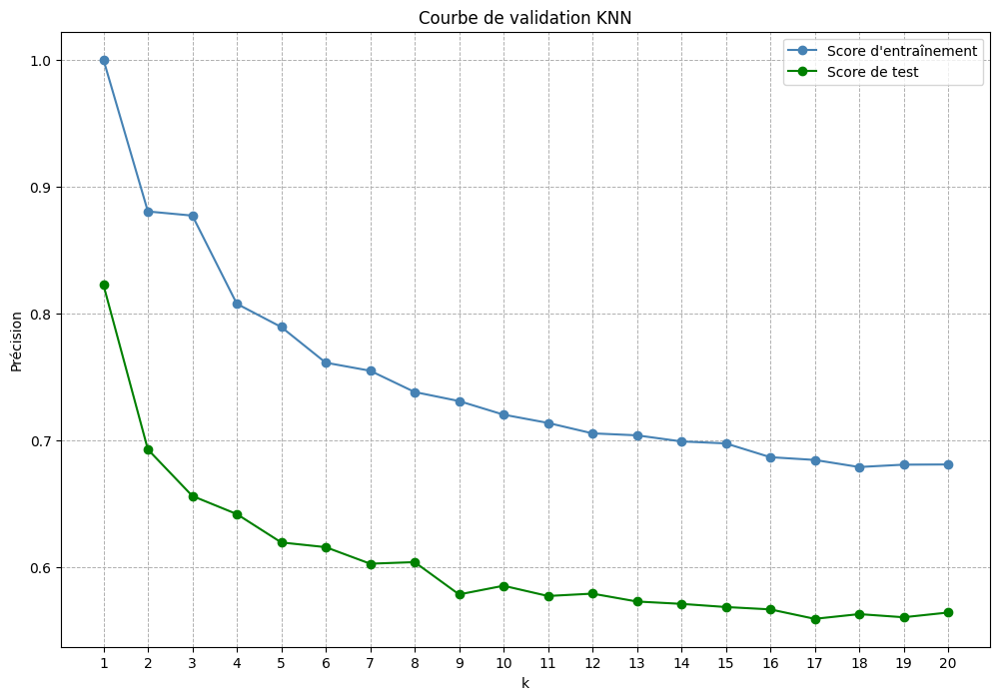
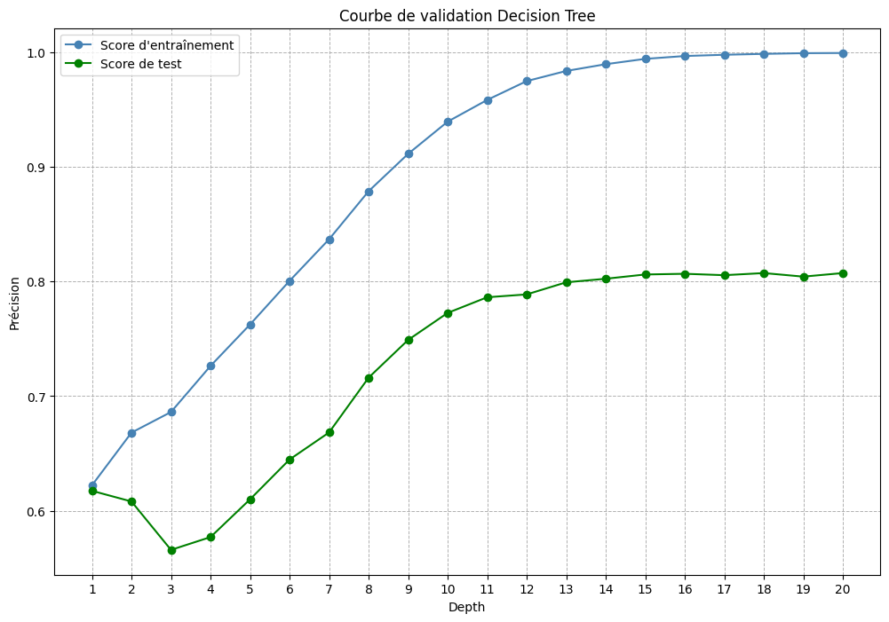
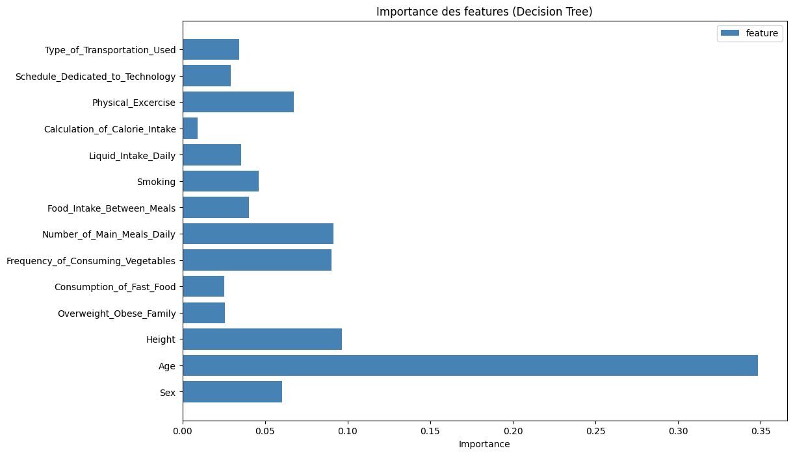
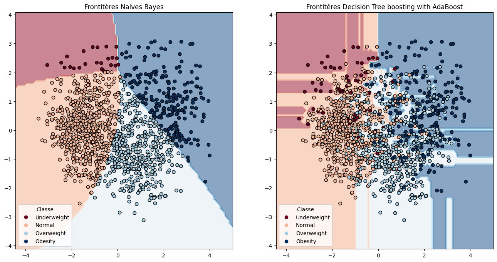
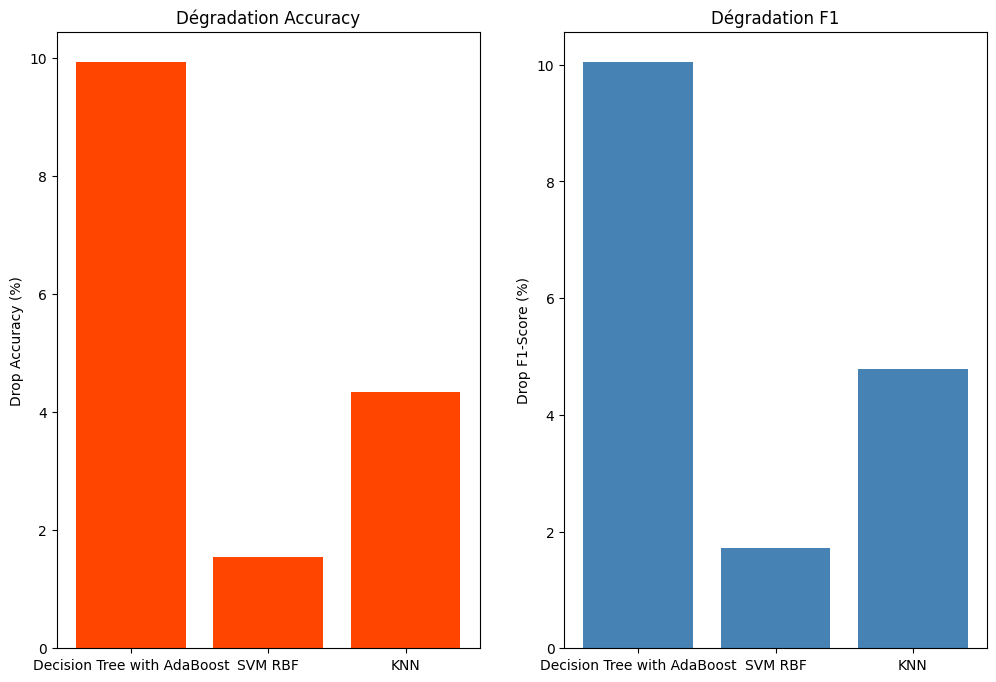

# Obesity Classification

Projet de classification supervisée pour prédire le statut pondéral d'un individu (Underweight, Normal, Overweight, Obesity) à partir de données médicales. Le pipeline inclut l'exploration des données, l'entraînement de plusieurs classifieurs, la robustesse au bruit, la réduction de dimension.


## Données

- **Source** : https://www.kaggle.com/datasets/suleymansulak/obesity-dataset
- **Classes** : `Underweight`, `Normal`, `Overweight`, `Obesity`


##  Modèles entraînés

Le projet s'appuie sur une Régression Logistique (OvR) avec une implémentation personnalisée, ainsi que sur le modèle Naïve Bayes Gaussien. Pour la classification basée sur le voisinage et les structures arborescentes, on retrouve le K-Nearest Neighbors (KNN), le Decision Tree, et le modèle d'ensemble AdaBoost. Enfin, plusieurs variantes de machines à vecteurs de support ont été testées, à savoir le SVM Linéaire, le SVM Soft Margin et le SVM RBF.


## Meilleur modèle

Suite aux phases de test et de comparaison, le modèle **AdaBoost** s'est imposé comme le plus performant. En utilisant un **Arbre de Décision** comme estimateur de base, AdaBoost a permis de "booster" ses performances en corrigeant successivement les erreurs des modèles faibles. 

## Résultats et visualisations

### Courbe de validation du KNN



Avec un seul voisin, le score d'entraînement est parfait, mais le score de test est nettement plus faible : cet écart indique un surapprentissage. Lorsque le nombre de voisins augmente, l'écart se réduit, mais le score de test baisse également.

### Courbe de validation de l'arbre de décision



Le score de test progresse avec la profondeur puis se stabilise autour de 0,80, tandis que le score d'entraînement approche 1. L'écart entre les deux courbes montre qu'un arbre très profond peut surapprendre les données d'entraînement.

### Importance des variables



Dans cet arbre de décision, `Age` est la variable la plus importante selon la mesure d'importance du modèle. Cette mesure décrit la contribution des variables aux décisions de cet estimateur ; elle ne permet pas de conclure à une relation de causalité.

### Frontières de décision



Ces graphiques représentent les frontières de décision de Naïve Bayes et d'AdaBoost (avec un arbre de décision) dans une représentation en deux dimensions. Les couleurs de fond montrent les classes prédites par les modèles et les points représentent les observations. AdaBoost produit ici des frontières plus complexes.

### Robustesse des modèles



Le graphique compare la baisse de l'Accuracy et du F1-score lors du test de robustesse : plus la baisse est faible, moins le modèle est affecté par la perturbation testée. Dans cette expérience, le SVM RBF subit la baisse la plus faible, tandis qu'AdaBoost subit la plus forte. Le modèle le plus performant en classification n'est donc pas nécessairement le plus robuste.


## SetUp

```bash
git clone https://github.com/cestbryan-ng/Obesity-Classification.git
cd Obesity-Classification

pip install -r requirements.txt
```
